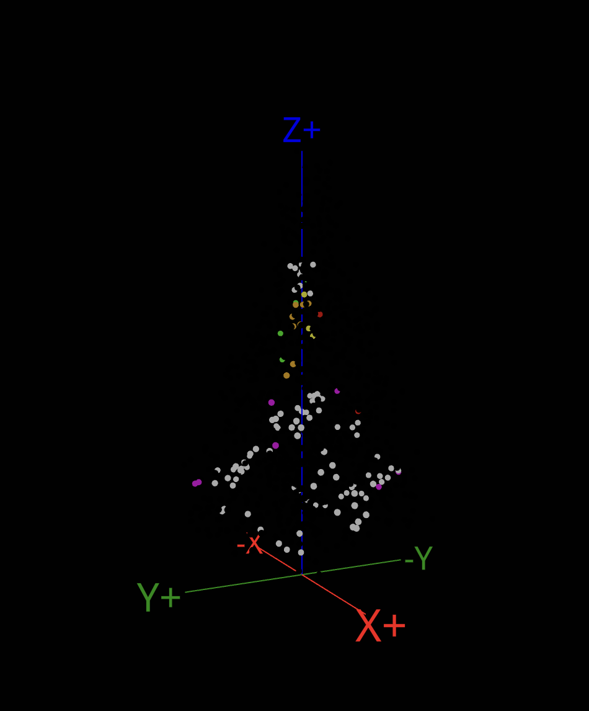
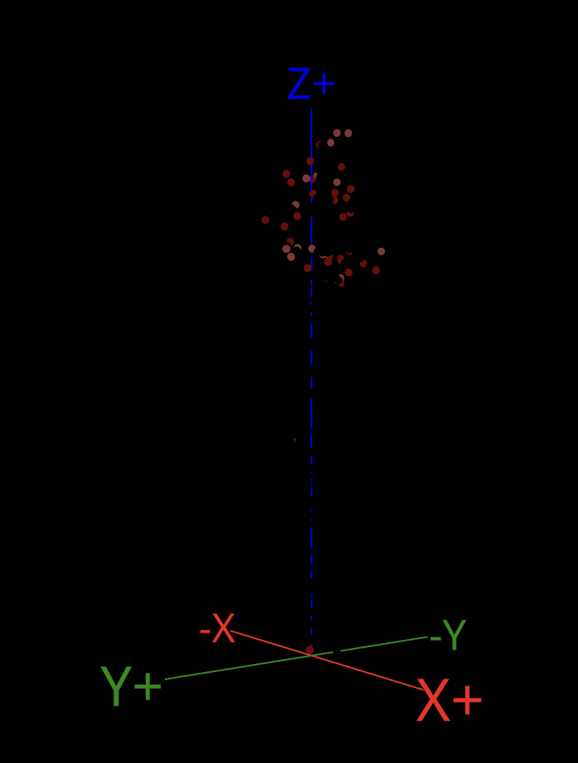
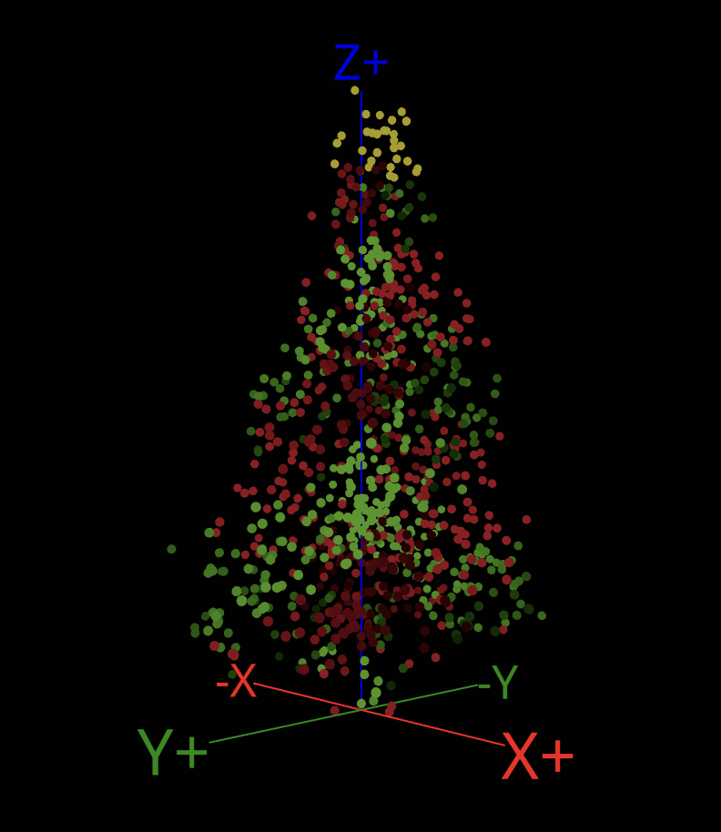
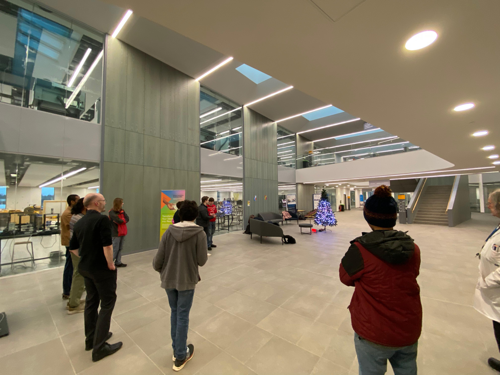
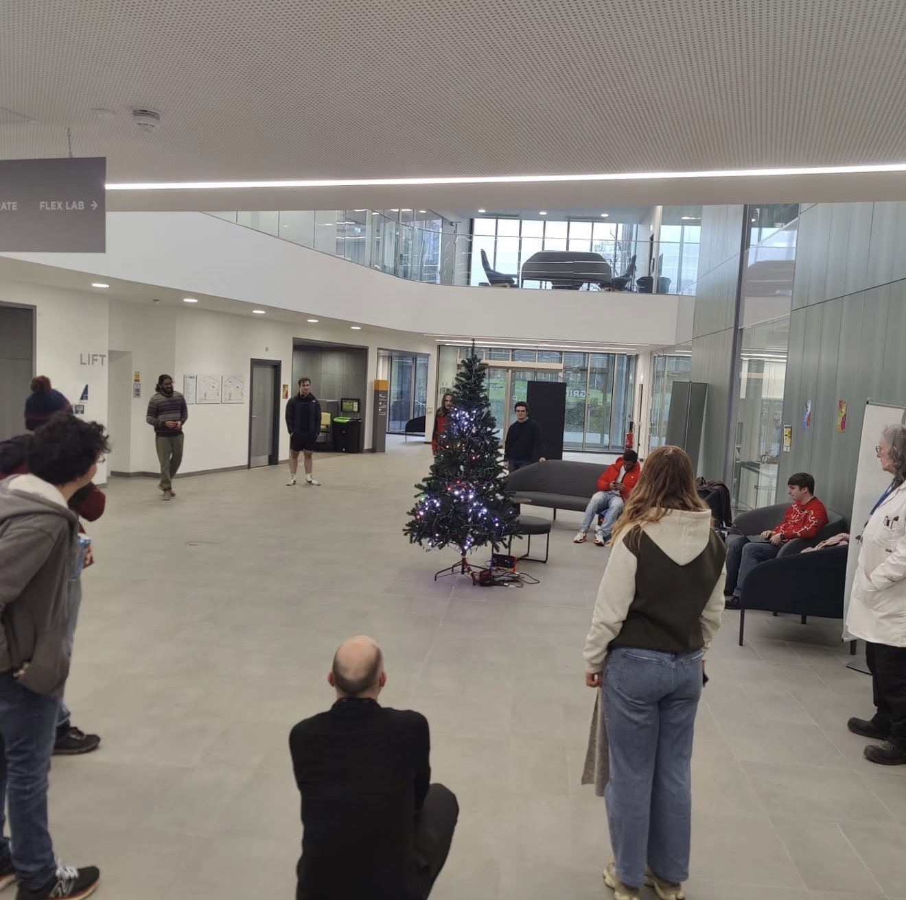

# GRIDmas 2024 — Results & Highlights

Thank you to everyone who took part in the GRIDmas programming challenge!  
Supported by Heriot-Watt Robotics Society, Heriot-Watt Makers Society, and the Heriot-Watt MACS department.

---

## 1st Place — **3D Vector Cube**

A beautifully rendered rotating cube in 3D space.  
This entry made seriously clever use of vector math and spatial transforms to produce a stable and very clean visual animation.
I've been told there are even secret messages hidden in the pattern for you to decipher.

**Entry:**  
[View the code / project →](https://gridmas-tree.vercel.app/p/bf83f57c-4df9-4d70-9ffd-76e4a56f269e)

**Preview:**  
{width=400}

---

## 2nd Place — **Pick Apples**

A wholesome interactive sequence that told the story of apples being picked from the top of the tree and carefully placed at the bottom.  
Charming, creative, and technically sound!

**Entry:**  
[View the code / project →](https://gridmas-tree.vercel.app/p/5ef98872-78c0-4d2a-bc4d-bb222aff29b5)

**Preview:**  
{width=400}

---

## 3rd Place — **Christmas Helix**

A festive DNA-like helix spiralling upward through the tree.  
Smooth timing, great use of space, and very *very* Christmas-core.

**Entry:**  
[View the code / project →](https://gridmas-tree.vercel.app/p/a5d677a8-6387-4377-b1dd-91f0864cabf9)

**Preview:**  
{width=400}

---

## Live Display Highlights

Here are some shots from the live tree during the showcase event:

| |
|:--:|
|  |
|  |

---
